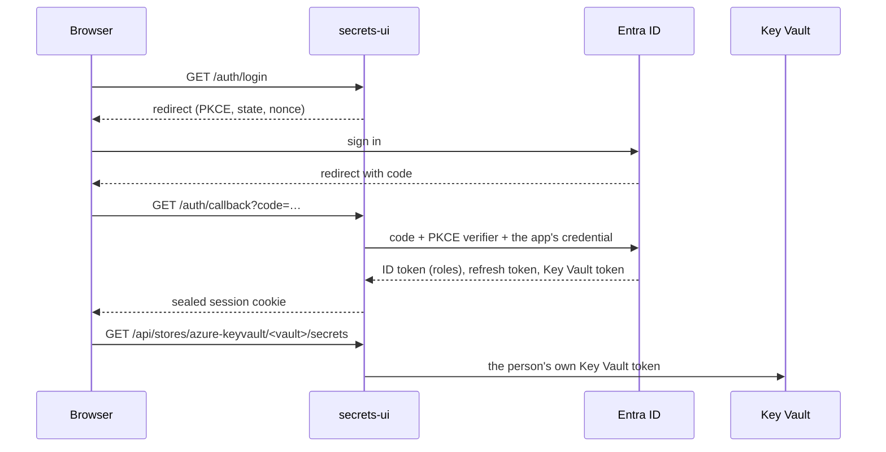

# secrets-ui

A small web UI for managing secrets in the stores you already use, without the cloud portal.
People sign in with Entra ID, see only the stores their app roles name, and every read or
change runs **as them**: the store's own access control decides what they may do, and its
audit log names the person, not the app.

The first provider is **Azure Key Vault**. HashiCorp Vault (KV v2) is next; the provider
interface in `src/secrets_ui/providers/` is built for it.

What you can do in a vault:

- list secrets with their status, expiry, last update and content type
- create a secret, add a new version, set or clear the expiry
- disable and enable a secret
- delete (soft delete) and recover; purging is left out on purpose
- reveal a value, after an explicit click, for a minute
- list a secret's earlier versions and reveal one the same way

## How it works



- **Backend for frontend.** The browser never holds a token. The FastAPI backend is a
  confidential client: it runs the authorization code flow with PKCE and keeps the person's
  refresh token in an AES-GCM sealed, `__Host-`, `HttpOnly`, `Secure`, `SameSite=Strict`
  cookie. Nothing is stored on the server, so any replica serves any request. Access tokens
  are cached in each replica's memory, never in the cookie: an Azure token carries the
  person's group ids and outgrows a cookie.
- **No standing access.** The app asks only for delegated permissions (Key Vault
  `user_impersonation`). It has no role on any vault.
- **No secret for the app either.** On Kubernetes the app's credential is its own projected
  service-account token, which Entra ID accepts through a federated credential. A client
  secret works too, where there is no workload identity.
- **Stores from roles.** An app role's value is a store name. A role counts only if it is a
  valid vault name and matches the operator's pattern (`SECRETS_UI_AZURE_KEYVAULT_ROLES`),
  so a privileged vault stays out even if its role is assigned by mistake. The server refuses
  any call to a store the session does not name, before it calls anything.
- **Values.** A value is fetched only by an explicit POST, comes back with `no-store`, lives
  in the page's memory for a minute, and is never logged, cached or put in a URL. Request
  validation errors never echo what was sent.
- **Browser hardening.** CSRF token plus `Origin` check on every write, a CSP of
  `default-src 'none'` with `'self'` for scripts and styles and no inline code, no framing,
  HSTS.

Network: the app calls `login.microsoftonline.com` and `<vault>.vault.azure.net` on 443. If
your vaults have a firewall, it has to allow the app's egress address, not the people's.

## Set up the app registration

One registration, single tenant:

1. **Redirect URI** (Web): `https://<your host>/auth/callback`.
2. **App roles**, one per vault: value = the vault name, allowed member type User. Assign each
   role to the group that should manage that vault.
3. **Assignment required** on the enterprise application, so someone with no role cannot sign
   in at all.
4. **Delegated permissions**: Azure Key Vault `user_impersonation`, and Microsoft Graph
   `openid`, `profile` and `offline_access`. Grant admin consent, so nobody sees a prompt.
5. **Credential**: a federated credential with your cluster's service-account issuer, subject
   `system:serviceaccount:<namespace>:<service account>` and audience
   `api://AzureADTokenExchange`. Or a client secret.
6. **The vaults themselves** use Azure RBAC (for example Key Vault Secrets Officer for the same
   group). That is what decides what each person may do.

With the Azure CLI, the core of it:

```bash
app=$(az ad app create --display-name secrets-ui --sign-in-audience AzureADMyOrg \
  --web-redirect-uris https://secrets.example.com/auth/callback --query appId -o tsv)
az ad sp create --id "$app"
az ad sp update --id "$app" --set appRoleAssignmentRequired=true
# Azure Key Vault user_impersonation
az ad app permission add --id "$app" --api cfa8b339-82a2-471a-a3c9-0fc0be7a4093 \
  --api-permissions f53da476-18e3-4152-8e01-aec403e6edc0=Scope
az ad app permission admin-consent --id "$app"
```

App roles, role assignments and the federated credential are easiest in Terraform
(`azuread_application`, `azuread_app_role_assignment`,
`azuread_application_federated_identity_credential`).

## Install

```bash
helm install secrets-ui oci://ghcr.io/magmamoose/charts/secrets-ui \
  --namespace secrets-ui --create-namespace \
  --set azure.tenantId=<tenant id> \
  --set azure.clientId=<app id> \
  --set config.publicOrigin=https://secrets.example.com \
  --set providers.azureKeyVault.roles='^(team-a|team-b)-keyvault-(dev|prd)$' \
  --set ingress.enabled=true --set ingress.className=traefik
```

The chart runs two replicas with a PodDisruptionBudget, a read-only root filesystem, no
Kubernetes API token and the restricted Pod Security profile. It creates the cookie key on
install and keeps it on upgrade (`session.existingSecret` to bring your own). See
[`charts/secrets-ui/values.yaml`](charts/secrets-ui/values.yaml).

## Configuration

| Variable | Default | Meaning |
|---|---|---|
| `AZURE_TENANT_ID` | | Entra ID tenant (GUID) |
| `AZURE_CLIENT_ID` | | The app registration |
| `AZURE_FEDERATED_TOKEN_FILE` | | Workload identity token file (the app's credential) |
| `AZURE_CLIENT_SECRET` / `_FILE` | | Or a client secret |
| `AZURE_AUTHORITY_HOST` | `https://login.microsoftonline.com` | Another cloud's sign-in host |
| `SECRETS_UI_PUBLIC_ORIGIN` | | `https://host`, where people open the UI |
| `SECRETS_UI_SESSION_KEY` / `_FILE` | | Seals the session cookie; 32+ characters, the same on every replica |
| `SECRETS_UI_SESSION_HOURS` | `8` | Sign-in lifetime, 1 to 24 |
| `SECRETS_UI_BRAND_ACCENT` / `_TEXT` | | Your colours as `#rrggbb`: the accent (buttons, links, the selected store, the logo) and the text on it |
| `SECRETS_UI_BRAND_ACCENT_DARK` / `_TEXT_DARK` | the two above | The same for dark mode |
| `SECRETS_UI_PROVIDERS` | `azure-keyvault` | Which providers to offer |
| `SECRETS_UI_AZURE_KEYVAULT_ROLES` | `.+` | Pattern a role must match to count as a vault |
| `SECRETS_UI_AZURE_KEYVAULT_SUFFIX` | `vault.azure.net` | Key Vault DNS suffix |
| `SECRETS_UI_AZURE_KEYVAULT_STORES` | | How vaults show, as JSON: `[{"name": "team-a-keyvault-dev", "label": "team-a-dev"}]`. Listed vaults come first, in this order, under their label; the rest follow by name. It grants nothing |

## Develop

```bash
uv sync
uv run pytest
cd frontend && npm ci && npm run dev   # UI on :5173, proxies /api and /auth to :8080
```

The tests run the whole sign-in against a fake Entra ID (real signed tokens and JWKS) and a
fake Key Vault, including the role filter, the reveal path and the CSRF checks.

## License

Apache-2.0.
