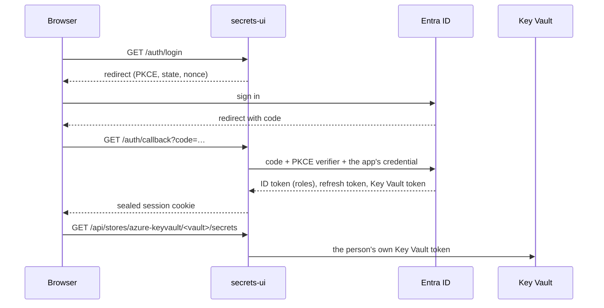

# secrets-ui

A small web UI for managing secrets in the stores you already use, without the cloud portal.
People sign in with Entra ID or Google Workspace, see only the stores their roles or groups
name, and every read or change runs **as them**: the store's own access control decides what
they may do, and its audit log names the person, not the app.

Three providers, on their own or together: **Azure Key Vault**, **HashiCorp Vault** (KV v2) and
**OCI Vault**.

What you can do in a vault:

- list secrets with their status, expiry, last update and content type
- create a secret, add a new version, set or clear the expiry
- disable and enable a secret
- delete (soft delete) and recover; purging is left out on purpose
- reveal a value, after an explicit click, for a minute
- list a secret's earlier versions, reveal one the same way, or make one current again
- read the vault's own audit log: who read or changed which secret, when, and from where
- copy a Kustomize example (an `ExternalSecret` and its `kustomization.yaml`) that reads a secret
  into Kubernetes with the External Secrets Operator

## How it works



- **Backend for frontend.** The browser never holds a token. The FastAPI backend is a
  confidential client: it runs the authorization code flow with PKCE and keeps the person's
  refresh token in an AES-GCM sealed, `__Host-`, `HttpOnly`, `Secure`, `SameSite=Strict`
  cookie. Nothing is stored on the server, so any replica serves any request. Access tokens
  are cached in each replica's memory, never in the cookie: an Azure token carries the
  person's group ids and outgrows a cookie.
- **No standing access.** The app asks only for delegated permissions (Key Vault
  `user_impersonation`). It has no role on any vault.
- **No secret for the app either.** On Kubernetes the app's credential is its own projected
  service-account token, which Entra ID accepts through a federated credential. A client
  secret works too, where there is no workload identity.
- **Stores from roles.** An app role's value is a store name. For Key Vault, a role counts
  only if it is a valid vault name and matches the operator's pattern
  (`SECRETS_UI_AZURE_KEYVAULT_ROLES`), so a privileged vault stays out even if its role is
  assigned by mistake; for HashiCorp Vault, only if it names a store the operator listed. The
  server refuses any call to a store the session does not name, before it calls anything.
- **HashiCorp Vault as the person.** The app presents a fresh Entra ID token (audience: the
  app, with the person's roles) to Vault's JWT auth method and uses the Vault token that comes
  back, kept in the replica's memory. Vault's policies decide what the person may do, and
  Vault's audit log names them.
- **Values.** A value is fetched only by an explicit POST, comes back with `no-store`, lives
  in the page's memory for a minute, and is never logged, cached or put in a URL. Request
  validation errors never echo what was sent.
- **Browser hardening.** CSRF token plus `Origin` check on every write, a CSP of
  `default-src 'none'` with `'self'` for scripts and styles and no inline code, no framing,
  HSTS.

Network: the app calls `login.microsoftonline.com` and `<vault>.vault.azure.net` on 443, your
HashiCorp Vault where it listens, and for OCI the identity domain and
`[secrets.]vaults.<region>.oci.oraclecloud.com`. If your vaults have a firewall, it has to allow the app's
egress address, not the people's.

## Set up the app registration

One registration, single tenant:

1. **Redirect URI** (Web): `https://<your host>/auth/callback`.
2. **App roles**, one per vault: value = the vault name, allowed member type User. Assign each
   role to the group that should manage that vault.
3. **Assignment required** on the enterprise application, so someone with no role cannot sign
   in at all.
4. **Delegated permissions**: Azure Key Vault `user_impersonation`, and Microsoft Graph
   `openid`, `profile` and `offline_access`. Grant admin consent, so nobody sees a prompt.
5. **Credential**: a federated credential with your cluster's service-account issuer, subject
   `system:serviceaccount:<namespace>:<service account>` and audience
   `api://AzureADTokenExchange`. Or a client secret.
6. **The vaults themselves** use Azure RBAC (for example Key Vault Secrets Officer for the same
   group). That is what decides what each person may do.

With the Azure CLI, the core of it:

```bash
app=$(az ad app create --display-name secrets-ui --sign-in-audience AzureADMyOrg \
  --web-redirect-uris https://secrets.example.com/auth/callback --query appId -o tsv)
az ad sp create --id "$app"
az ad sp update --id "$app" --set appRoleAssignmentRequired=true
# Azure Key Vault user_impersonation
az ad app permission add --id "$app" --api cfa8b339-82a2-471a-a3c9-0fc0be7a4093 \
  --api-permissions f53da476-18e3-4152-8e01-aec403e6edc0=Scope
az ad app permission admin-consent --id "$app"
```

App roles, role assignments and the federated credential are easiest in Terraform
(`azuread_application`, `azuread_app_role_assignment`,
`azuread_application_federated_identity_credential`).

## Set up HashiCorp Vault

A store is a folder in a KV v2 mount, such as `secret/dev/team-a`. A person sees it when an app
role on the registration (value: the store name) is assigned to them; Vault's policies decide
what they can do there. A value is the secret's JSON object of keys and values. Delete deletes
the current version (Deleted lists it and Recover undeletes it); expiry, disabling and content
types are Key Vault's and do not show for Vault.

Vault signs people in with their Entra ID token through the JWT auth method. Vault has to reach
`login.microsoftonline.com` for the tenant's keys:

```bash
vault auth enable jwt
vault write auth/jwt/config \
  oidc_discovery_url="https://login.microsoftonline.com/<tenant id>/v2.0" \
  bound_issuer="https://login.microsoftonline.com/<tenant id>/v2.0"
vault write auth/jwt/role/secrets-ui role_type=jwt \
  bound_audiences="<app id>" user_claim=oid groups_claim=roles \
  claim_mappings=preferred_username=upn token_ttl=1h token_max_ttl=1h

# Per store: a policy for its folder, and an external group named after the store's role.
vault policy write team-a-dev - <<'EOF'
path "secret/data/dev/team-a/*"     { capabilities = ["create", "read", "update", "delete"] }
path "secret/metadata/dev/team-a/*" { capabilities = ["read", "list"] }
path "secret/undelete/dev/team-a/*" { capabilities = ["update"] }
EOF
accessor=$(vault auth list -format=json | jq -r '."jwt/".accessor')
group=$(vault write -field=id identity/group name=team-a-dev type=external policies=team-a-dev)
vault write identity/group-alias name=team-a-vault-dev mount_accessor="$accessor" canonical_id="$group"
```

Then set `SECRETS_UI_PROVIDERS=azure-keyvault,hashicorp-vault` (or just `hashicorp-vault`),
`SECRETS_UI_HASHICORP_VAULT_ADDR` and `SECRETS_UI_HASHICORP_VAULT_STORES`, and keep the Vault
store names out of `SECRETS_UI_AZURE_KEYVAULT_ROLES`. On Kubernetes, a Vault on a private
address needs `networkPolicy.extraEgress`.

## Set up OCI Vault

A store is one OCI vault in one compartment. A person sees it when a role (Entra ID) or group
(Google) on their sign-in is the store's name; OCI's IAM policies decide what they can do there.

The app trades each person's ID token for an OCI session token of their own, through a token
exchange in your OCI identity domain, and signs every call with it. So OCI's audit log names the
person, and the app holds no OCI access of its own. In the identity domain:

1. Create a confidential application (client credentials, no app roles) that the exchange runs
   as: `SECRETS_UI_OCI_CLIENT_ID` and `SECRETS_UI_OCI_CLIENT_SECRET`.
2. Create an Identity Propagation Trust (`POST <domain>/admin/v1/IdentityPropagationTrusts`)
   that maps the sign-in's ID token to the person's own OCI user:

   ```json
   {
     "schemas": ["urn:ietf:params:scim:schemas:oracle:idcs:IdentityPropagationTrust"],
     "name": "secrets-ui",
     "type": "JWT",
     "active": true,
     "issuer": "https://login.microsoftonline.com/<tenant id>/v2.0",
     "publicKeyEndpoint": "https://login.microsoftonline.com/<tenant id>/discovery/v2.0/keys",
     "clientClaimName": "aud",
     "clientClaimValues": ["<app id>"],
     "subjectClaimName": "preferred_username",
     "subjectMappingAttribute": "userName",
     "subjectType": "User",
     "allowImpersonation": false,
     "oauthClients": ["<client id from step 1>"]
   }
   ```

   With Google sign-in: issuer `https://accounts.google.com`, keys
   `https://www.googleapis.com/oauth2/v3/certs`, the OAuth client id as `aud`, and `email` as the
   subject claim. People need an OCI user whose user name matches that claim.
3. Give people's OCI groups the policies for their vault, such as
   `allow group <domain>/<group> to manage secret-family in compartment <compartment>` and
   `allow group <domain>/<group> to use keys in compartment <compartment>` (new secrets are
   encrypted with the store's master key).

Then set `SECRETS_UI_PROVIDERS` to include `oci-vault`, and `SECRETS_UI_OCI_REGION`,
`SECRETS_UI_OCI_DOMAIN_URL` and `SECRETS_UI_OCI_STORES`. A value is the secret's text. Delete
schedules the deletion with OCI's default retention, and Recover cancels it; restoring a version
points the secret back at it without moving the value.

## Sign in with Google

With `SECRETS_UI_SIGN_IN=google`, people sign in with their Google Workspace account instead of
Entra ID. Azure Key Vault takes Entra ID tokens only, so it is off then; HashiCorp Vault and OCI
Vault work.

1. In a Google Cloud project of your organisation, set the OAuth consent screen to Internal and
   enable the Cloud Identity API.
2. Create an OAuth client of type Web application, with the redirect URI
   `https://<your host>/auth/callback`: `GOOGLE_CLIENT_ID` and `GOOGLE_CLIENT_SECRET`.
3. Set `SECRETS_UI_GOOGLE_DOMAINS` to your Workspace domains. Only an account whose verified
   `hd` claim names one of them gets in.
4. Stores come from Google Groups: a group in one of those domains whose name is a store name,
   such as `team-a-vault-dev@example.com`, gives its direct members that store. The app reads a
   person's groups once at sign-in, with their own token (`cloud-identity.groups.readonly`).

Google hands out a refresh token only on consent, so every sign-in asks for it. For HashiCorp
Vault, the JWT auth mount trusts Google instead: `oidc_discovery_url` and `bound_issuer`
`https://accounts.google.com`, the role's `bound_audiences` the OAuth client id, `user_claim=email`
and `bound_claims` on `hd`. Google ID tokens carry no groups: let Vault fetch them with its
Google `provider_config` (`fetch_groups`), or give the role its policies directly.

## Show a vault's audit log

Optional, per vault. The log is the vault's own `AuditEvent` records, read through the Log
Analytics API with the person's token, so Azure RBAC decides who sees it:

1. The vault has a diagnostic setting that sends the `audit` category to a Log Analytics
   workspace (either destination table, `AzureDiagnostics` or `AZKVAuditLogs`).
2. The app registration has the delegated permission Log Analytics API `Data.Read`, with admin
   consent. Without it, the audit log answers "no access" and everything else keeps working.
3. People may read the vault's logs: Reader on the vault, or a role with
   `Microsoft.Insights/logs/AzureDiagnostics/read` and `Microsoft.Insights/logs/AZKVAuditLogs/read`.
4. The vault is listed in `SECRETS_UI_AZURE_KEYVAULT_STORES` with its `resource_id`.

The UI shows the last 30 days of reads and changes (not listings), newest first. The app calls
`api.loganalytics.azure.com` for it.

## Install

```bash
helm install secrets-ui oci://ghcr.io/magmamoose/charts/secrets-ui \
  --namespace secrets-ui --create-namespace \
  --set azure.tenantId=<tenant id> \
  --set azure.clientId=<app id> \
  --set config.publicOrigin=https://secrets.example.com \
  --set providers.azureKeyVault.roles='^(team-a|team-b)-keyvault-(dev|prd)$' \
  --set ingress.enabled=true --set ingress.className=traefik
```

The chart runs two replicas with a PodDisruptionBudget, a read-only root filesystem, no
Kubernetes API token and the restricted Pod Security profile. It creates the cookie key on
install and keeps it on upgrade (`session.existingSecret` to bring your own). See
[`charts/secrets-ui/values.yaml`](charts/secrets-ui/values.yaml).

## Configuration

| Variable | Default | Meaning |
|---|---|---|
| `SECRETS_UI_SIGN_IN` | `entra` | Who people sign in with: `entra` or `google` |
| `AZURE_TENANT_ID` | | Entra ID tenant (GUID) |
| `AZURE_CLIENT_ID` | | The app registration |
| `AZURE_FEDERATED_TOKEN_FILE` | | Workload identity token file (the app's credential) |
| `AZURE_CLIENT_SECRET` / `_FILE` | | Or a client secret |
| `AZURE_AUTHORITY_HOST` | `https://login.microsoftonline.com` | Another cloud's sign-in host |
| `GOOGLE_CLIENT_ID` | | With Google: the OAuth client id |
| `GOOGLE_CLIENT_SECRET` / `_FILE` | | With Google: its client secret |
| `SECRETS_UI_GOOGLE_DOMAINS` | | With Google: the Workspace domains whose accounts may sign in |
| `SECRETS_UI_PUBLIC_ORIGIN` | | `https://host`, where people open the UI |
| `SECRETS_UI_SESSION_KEY` / `_FILE` | | Seals the session cookie; 32+ characters, the same on every replica |
| `SECRETS_UI_SESSION_HOURS` | `8` | Sign-in lifetime, 1 to 24 |
| `SECRETS_UI_BRAND_ACCENT` / `_TEXT` | | Your colours as `#rrggbb`: the accent (buttons, links, the selected store, the logo) and the text on it |
| `SECRETS_UI_BRAND_ACCENT_DARK` / `_TEXT_DARK` | the two above | The same for dark mode |
| `SECRETS_UI_PROVIDERS` | `azure-keyvault` (none with Google) | Which providers to offer: any of `azure-keyvault`, `hashicorp-vault` and `oci-vault` |
| `SECRETS_UI_AZURE_KEYVAULT_ROLES` | `.+` | Pattern a role must match to count as a vault |
| `SECRETS_UI_AZURE_KEYVAULT_SUFFIX` | `vault.azure.net` | Key Vault DNS suffix |
| `SECRETS_UI_HASHICORP_VAULT_ADDR` | | `https://vault.example.com:8200` |
| `SECRETS_UI_HASHICORP_VAULT_STORES` | | The stores, in the order to show them, as JSON: `[{"name": "team-a-vault-dev", "label": "team-a-dev", "mount": "secret", "path": "dev/team-a"}]`. A person sees a store when an app role is its name. `secret_store` as for Key Vault; the example expects its `path` to be the mount |
| `SECRETS_UI_HASHICORP_VAULT_AUTH_MOUNT` | `jwt` | The JWT auth mount |
| `SECRETS_UI_HASHICORP_VAULT_AUTH_ROLE` | `secrets-ui` | The role on that mount |
| `SECRETS_UI_HASHICORP_VAULT_CA_FILE` | | PEM bundle of a private CA, trusted for the calls to Vault only |
| `SECRETS_UI_OCI_REGION` | | The vaults' region, such as `eu-amsterdam-1` |
| `SECRETS_UI_OCI_DOMAIN_URL` | | The identity domain that runs the token exchange, `https://idcs-….identity.oraclecloud.com` |
| `SECRETS_UI_OCI_CLIENT_ID` / `_CLIENT_SECRET` / `_FILE` | | Its confidential app, the one the exchange runs as |
| `SECRETS_UI_OCI_STORES` | | The stores, in the order to show them, as JSON: `[{"name": "team-a-oci-dev", "label": "team-a-dev", "compartment": "ocid1.compartment…", "vault": "ocid1.vault…", "key": "ocid1.key…"}]`. `secret_store` as for Key Vault |
| `SECRETS_UI_AZURE_KEYVAULT_STORES` | | How vaults show, as JSON: `[{"name": "team-a-keyvault-dev", "label": "team-a-dev", "resource_id": "/subscriptions/…/vaults/team-a-keyvault-dev"}]`. Listed vaults come first, in this order, under their label; the rest follow by name. A `resource_id` shows the vault's audit log; `secret_store` names the External Secrets store the Kustomize example uses (default: a `ClusterSecretStore` named after the vault, or `SecretStore/<name>`). It grants nothing |

## Develop

```bash
uv sync
uv run pytest
cd frontend && npm ci && npm run dev   # UI on :5173, proxies /api and /auth to :8080
```

The tests run the whole sign-in against a fake Entra ID (real signed tokens and JWKS) and a
fake Key Vault, HashiCorp Vault, Google and OCI (which checks every request's signature),
including the role filter, the reveal path and the CSRF checks.

## License

Apache-2.0.
